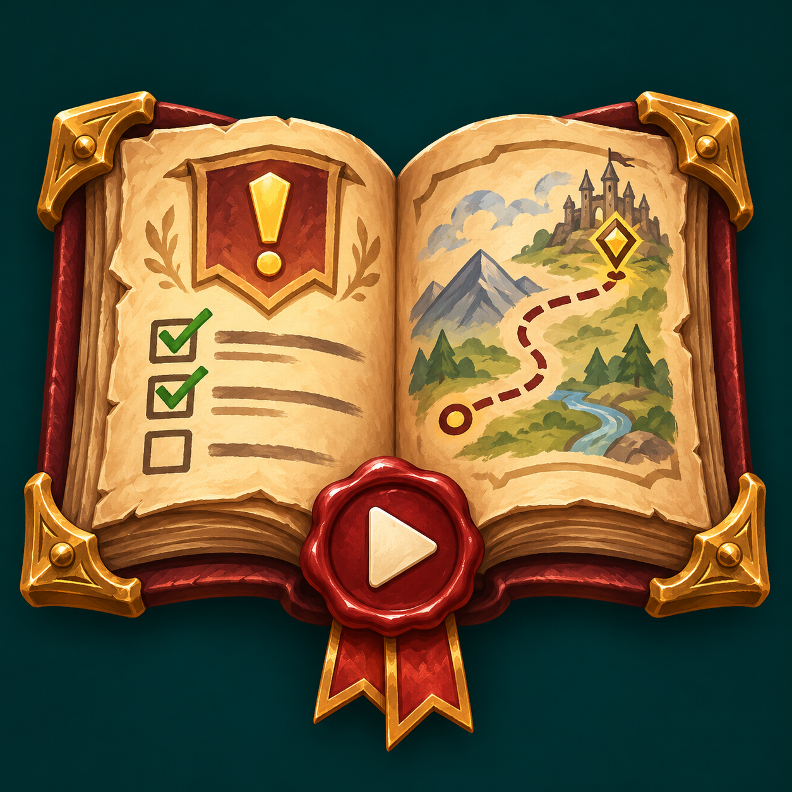
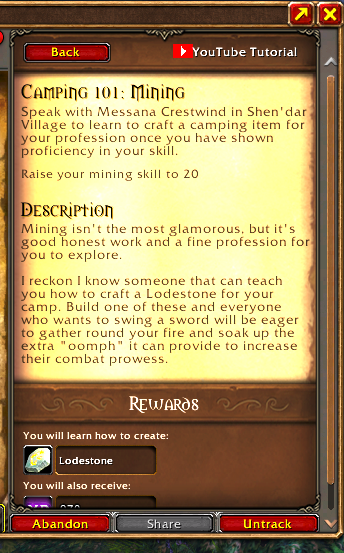

# Video Quest Helper

Stuck on a quest in **World of Warcraft: Forever (1.60.1)**? Open its details in the quest log and click **YouTube Tutorial**.

- **Quest with a saved video:** Get a direct link to the walkthrough, with a timestamp where available. The starter catalog includes the Cozy Sleeping Bag chain and The Horn of Xelthos.
- **Other quests:** Get a YouTube search using the quest name and “WoW Forever”. The search works even when the catalog has no video for that quest.
- **Your own links:** Save a walkthrough with `/vqh set QUEST_ID VIDEO_ID`. Use `/vqh clear QUEST_ID` to remove your saved link.

## Windows setup for one-click opening

1. Download [VideoQuestHelper-Windows-0.2.7.zip](https://github.com/sobata1995-source/VideoQuestHelper/releases/download/v0.2.7/VideoQuestHelper-Windows-0.2.7.zip) and extract the entire archive.
2. Copy the extracted **VideoQuestHelper** folder into `World of Warcraft\_forever_\Interface\AddOns`.
3. Open the extracted **VideoQuestHelperWindows** folder and run **Install-Windows-Helper.cmd once**. Confirm when prompted. The helper starts in the background immediately and starts automatically each time you sign in to Windows. You can close the installer window after setup finishes.
4. Open WoW Forever. If it is already running, type `/reload`. Open a quest in the journal and click **YouTube Tutorial**. Use Windowed or Windowed (Fullscreen) mode.

The button opens a saved walkthrough when one is available. For other quests, it opens a YouTube search using the quest name. Automatic opening is enabled by default in this Windows package. If you previously chose manual mode, use `/vqh auto` to switch it back on.

## Addon-only download

**VideoQuestHelper-0.2.7.zip** contains the addon for WoW Forever 1.60.1. In the default mode the button displays a link to copy. Type `/vqh manual` to return to this mode at any time.

## Contact and support

Created by **Razer Dev Studio / Denis Aleksandrov**. Video Quest Helper is free to download and use. Donations are optional.

- [Discord community](https://discord.gg/Pr5eMAUqt) for feedback and video suggestions
- [GitHub Issues](https://github.com/sobata1995-source/VideoQuestHelper/issues) for bug reports
- [Support on Patreon](https://www.patreon.com/c/DenisAleksandrov/membership)
- [Leave a tip via Revolut](https://revolut.me/denisar2z)

